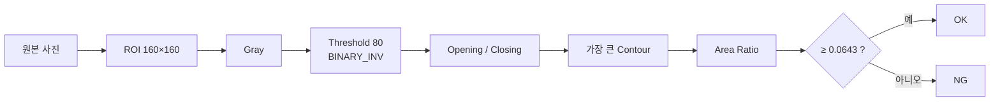

# practice — 충전기 케이블 체결 검사

> 충전기에 케이블이 **꽂혀 있으면 OK, 없으면 NG**.
> 교과 9 머신비전 1~3일차(ROI → Threshold → Contour → Rule) 흐름을 내 사진으로 다시 해 보고,
> FastAPI 웹 검사 화면과 IP Webcam 실시간 검사까지 확장한 복습 프로젝트입니다.


## 한눈에 보기

| 항목 | 내용 |
|---|---|
| 검사 대상 | 충전기 + 검은 케이블 (꽂힘 = OK / 빠짐 = NG) |
| 사용 데이터 | 휴대폰 원본 사진 2장 → 조건 변화 테스트 이미지 10장 |
| 판정 방법 | 고정 Threshold 80 → 가장 큰 Contour의 Area Ratio ≥ 0.0643 이면 OK |
| 결과 | 테스트 10장 중 **9장 정답 (90%)** |
| 확장 | FastAPI 사진 검사 화면 + IP Webcam 실시간 검사 |

## 검사 흐름



## 빠른 실행

프로젝트 최상위(`subject9_machinevision`)에서 실행합니다.

```bash
# 1~3일차 흐름
python practice/src/p01_make_reference.py    # 원본 2장 → 기준 ROI (ok.jpg / ng.jpg)
python practice/src/p02_make_test_images.py  # 밝게·어둡게·이동·노이즈·블러 테스트 이미지 10장
python practice/src/p03_feature_compare.py   # Otsu vs 고정 Threshold 비교
python practice/src/p04_make_rule.py         # 기준값 계산 → configs/cable_rule.json
python practice/src/p05_batch_test.py        # 테스트 10장 판정 + 정확도

# API
python practice/src/p06_api_test.py                                              # 서버 없이 API 테스트
uvicorn api_server:app  --app-dir practice/src --reload                          # 사진 검사 → :8000
uvicorn live_server:app --app-dir practice/src --host 0.0.0.0 --port 8001        # 실시간 검사 → :8001
```

서버 종료는 `Ctrl + C`, API 문서는 http://127.0.0.1:8000/docs 에서 볼 수 있습니다.

## 실험 과정

### 1. 기준 ROI 만들기 (p01)

원본 사진에서 충전기 입구를 중심으로 160×160 ROI를 잘라 기준 이미지로 사용했습니다.

| OK (케이블 있음) | NG (케이블 없음) |
|---|---|
|  |  |

### 2. Threshold 방법 비교 (p03) — Otsu를 버린 이유

| 측정 방법 | OK Area Ratio | NG Area Ratio | 판단 |
|---|---|---|---|
| Otsu (3일차 교재 방식) | 0.167 | **0.911** | NG가 더 큼 → 방향이 거꾸로, 사용 안 함 |
| 고정 Threshold 80 | 0.129 | 0.000 | OK > NG → **채택** |


Otsu는 이미지를 **무조건 두 그룹으로 나눕니다.** 그래서 어두운 케이블이 없는 NG 이미지에서는
배경의 어두운 부분을 "물체"로 잡아 면적이 오히려 커졌습니다.

### 3. Rule 고정 (p04)

OK와 NG 측정값의 중간을 기준값으로 정하고 `configs/cable_rule.json`에 저장했습니다.
테스트 결과를 본 뒤 기준값을 다시 바꾸지 않도록 Rule을 파일로 고정합니다. (5일차 Rule Freeze)

```json
{ "rule_version": "cable-v1.0", "method": "fixed", "fixed_threshold": 80,
  "area_ratio_threshold": 0.0643, "ok_when_greater": true }
```

### 4. Batch Test (p05)


| 조건 | OK 이미지 | NG 이미지 |
|---|---|---|
| blur | ✅ 0.108 | ✅ 0.000 |
| bright (+30) | ❌ **0.049 → NG 오판정** | ✅ 0.000 |
| dark (×0.7) | ✅ 0.167 | ✅ 0.000 |
| noise | ✅ 0.128 | ✅ 0.000 |
| shift | ✅ 0.135 | ✅ 0.000 |

## 실패 분석: `ok_bright`

- 밝기를 +30 올리자 어두운 부분 일부의 밝기가 80을 넘어 Binary에서 사라졌습니다.
- Area Ratio가 0.129 → 0.049로 줄어 기준값 0.0643 아래로 떨어졌습니다.
- 결과 이미지를 보면 측정 면적의 대부분은 케이블 목 부분보다 **위쪽 케이블 릴(감개)** 에서 나옵니다.
  즉 지금 Rule은 "케이블"보다 "ROI 안의 어두운 물체 크기"를 재고 있다는 한계가 있습니다.

**개선 아이디어 (한 번에 하나씩 바꿔서 실험)**
- ROI를 충전기 입구 쪽으로 더 좁게 잡아 릴이 들어오지 않게 하기
- 고정 Threshold 대신 밝기 변화에 덜 민감한 방법 시도 (예: CLAHE 후 Threshold)
- 같은 사진의 변형이 아닌, 새로 촬영한 사진으로 다시 평가하기

## 웹 검사 화면 (FastAPI)

### 사진 검사 — `api_server.py` (:8000)

샘플 검사, 테스트 전체 검사, 내 사진 업로드 + ROI 드래그 검사, 최근 기록을 볼 수 있습니다.


| Method | 주소 | 역할 |
|---|---|---|
| GET | `/` | 검사 화면 |
| GET | `/api/health` | 서버 상태 + Rule 버전 |
| GET | `/api/rule` | 현재 Rule 보기 |
| POST | `/api/reload-rule` | Rule 파일 다시 읽기 |
| GET | `/api/samples` | reference / test 이미지 목록 |
| POST | `/api/inspect/sample` | 저장된 샘플 1장 검사 |
| POST | `/api/inspect/upload` | 업로드 이미지(Base64) + ROI 검사 |
| GET / DELETE | `/api/history` | 최근 검사 기록 보기 / 지우기 |

### IP Webcam 실시간 검사 — `live_server.py` (:8001)

깃의 `src/fastapi_cap_app.py`와 같은 구조(LiveState + 카메라 스레드 + MJPEG 스트림)입니다.

1. 휴대폰 IP Webcam 앱에서 「서버 시작」 (PC와 같은 Wi-Fi)
2. http://127.0.0.1:8001 → `http://휴대폰IP:8080/video` 입력 → 카메라 연결
3. 영상에서 충전기 입구를 드래그해 ROI 지정 → 실시간 OK / NG
4. 판정이 이상하면 웹캠 기준을 다시 잡기: 「OK 기준 저장」 → 「NG 기준 저장」 → 「웹캠 Rule 만들기」
   → `configs/cable_rule_live.json` (cable-live-v1.0) 생성 후 바로 적용

| Method | 주소 | 역할 |
|---|---|---|
| POST | `/api/camera` | IP Webcam 주소 연결 (사설 IP만 허용) |
| POST / DELETE | `/api/roi` | ROI 지정 / 초기화 |
| GET | `/api/status` | 실시간 판정·Ratio·Rule 상태 |
| GET | `/stream.mjpg` | 검사 결과가 그려진 실시간 영상 |
| POST | `/api/reference/{ok\|ng}` | 현재 ROI를 웹캠 기준 이미지로 저장 |
| POST | `/api/live-rule` | 웹캠 기준 2장으로 Rule 생성 + 적용 |
| POST | `/api/use-rule` | `photo` / `live` Rule 바꾸기 |

코드 구조: `api_server.py` / `live_server.py` (요청·응답) → `cable_inspector.py` (검사 Service Core) → `cable_features.py` (측정)

## 폴더 구조

```text
practice/
├── README.md
├── docs/                      README용 화면 캡처
├── samples/
│   ├── raw/                   ok_raw.png, ng_raw.png (휴대폰 원본)
│   ├── reference/             ok.jpg, ng.jpg (p01)
│   └── test/                  ok_*.jpg, ng_*.jpg (p02)
├── src/
│   ├── cable_features.py      공통 측정 함수
│   ├── p01 ~ p05              1~3일차 흐름
│   ├── cable_inspector.py     검사 Service Core
│   ├── api_server.py          FastAPI 사진 검사
│   ├── live_server.py         FastAPI 실시간 검사
│   └── p06_api_test.py        API 자동 테스트
├── web/
│   ├── cable_inspection.html  사진 검사 화면
│   └── cable_live.html        실시간 검사 화면
├── configs/cable_rule.json    p04 Rule
├── outputs/                   결과 이미지
└── reports/                   결과 CSV
```

## 배운 점

- **측정이 먼저, Rule은 나중.** p03에서 숫자로 비교하지 않았다면 Otsu가 거꾸로 동작하는 걸 몰랐을 것이다.
- **Otsu는 만능이 아니다.** 물체가 없어도 반드시 둘로 나누기 때문에 "있다/없다" 검사에서는 함정이 될 수 있다.
- **Rule은 파일로 고정한다.** 테스트를 보고 기준을 고치면 그건 테스트가 아니라 맞추기가 된다.
- **같은 사진의 변형은 진짜 테스트가 아니다.** 실제 성능은 새로 찍은 사진·실시간 영상으로 다시 확인해야 한다.
- **검사 로직과 API를 분리하면** 사진 검사·실시간 검사가 같은 `cable_inspector.py`를 그대로 재사용할 수 있다.

## 다음 할 일

- [ ] 실제 IP Webcam으로 실시간 검사 + 웹캠 Rule 만들기
- [ ] 새로 촬영한 OK / NG 사진으로 재평가
- [ ] `ok_bright` 개선 실험 (ROI 축소 또는 CLAHE) → `cable-v1.1`
