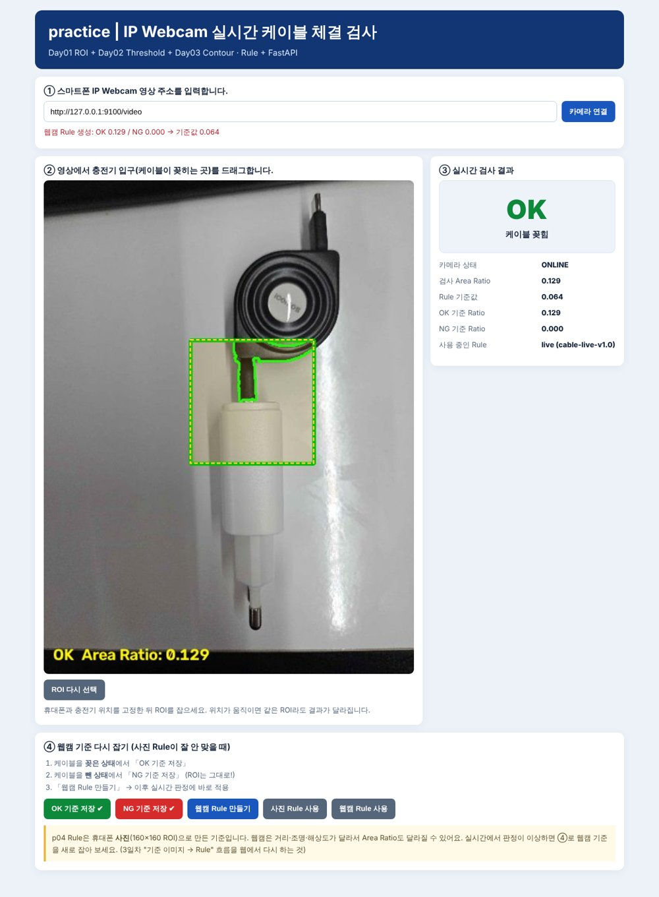

# prj09 — 교과 9 머신비전 실습

OpenCV로 이미지를 측정하고, 규칙(Rule)으로 OK / NG를 판정하는 머신비전 검사 실습 저장소입니다.

## 수업 실습 (`src/`)

| 일차 | 파일 | 내용 |
|---|---|---|
| 1일차 | `00` ~ `08` | 환경 확인, 이미지·영상 읽기, ROI, 웹캠·휴대폰 카메라 |
| 2일차 | `09` ~ `17` | 색공간, 밝기·대비, Gamma, CLAHE, 필터, Threshold(Otsu), 전처리 비교 |
| 3일차 | `18` ~ `23` | Morphology, Contour 측정, 병뚜껑 유무 Rule, Batch Test |
| API | `cap_inspector.py`, `fastapi_cap_app.py`, `web/` | IP Webcam 실시간 병뚜껑 검사 (FastAPI) |

```bash
# 실시간 병뚜껑 검사 실행
uvicorn src.fastapi_cap_app:app --reload
```

## 복습 프로젝트

### [practice — 충전기 케이블 체결 검사](practice/)



1~3일차 흐름을 내 사진으로 다시 해 보고 FastAPI 사진 검사 + IP Webcam 실시간 검사까지 확장했습니다.
테스트 10장 중 9장 정답, Otsu를 버린 이유와 실패 분석은 [practice/README.md](practice/README.md)에 정리했습니다.

## 폴더 구조

```text
prj09/
├── src/        수업 실습 코드 (00 ~ 23) + 병뚜껑 검사 API
├── web/        병뚜껑 검사 화면
├── samples/    실습 이미지·영상
├── outputs/    실습 결과 이미지
├── reports/    결과 CSV, 문제 정의
└── practice/   복습 프로젝트 (케이블 체결 검사)
```
